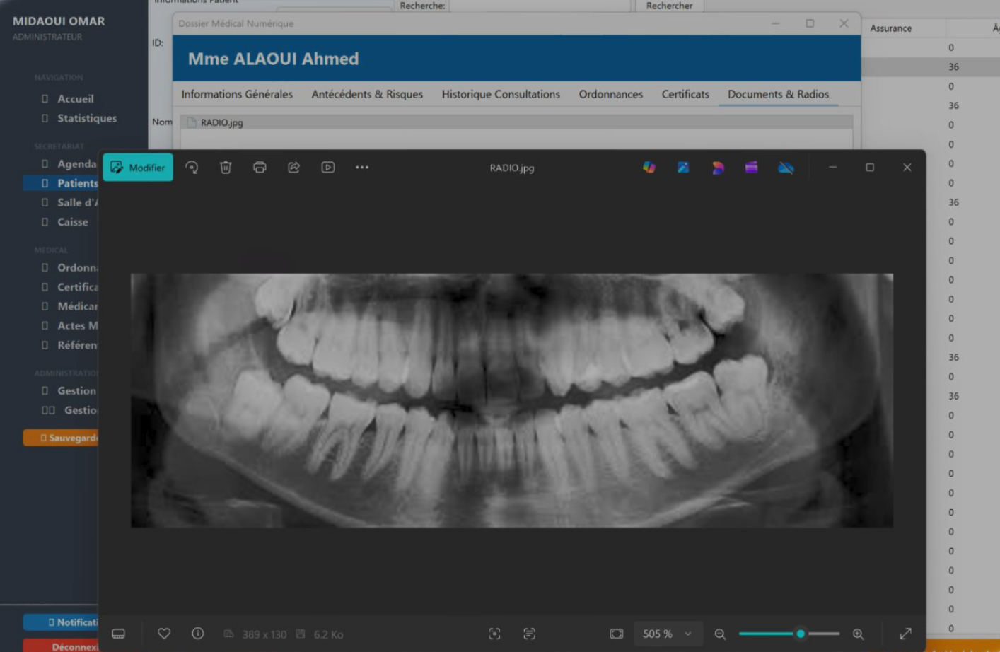

<div align="center">

# 🦷 DentalTech — Système de Gestion Intégré de Cabinet Dentaire

[](https://www.oracle.com/java/)
[](https://maven.apache.org/)
[](https://www.formdev.com/flatlaf/)
[](https://www.postgresql.org/)
[](https://mindrot.org/projects/jBCrypt/)
[](https://youtu.be/GhjsUnMQKuQ)

<p align="center">
  <b>Une solution logicielle moderne, intuitive et modulaire pour la gestion administrative, médicale, financière et clinique des cabinets dentaires.</b>
</p>

[Fonctionnalités](#-fonctionnalités-principales) •
[Aperçu Visuel](#-aperçu-de-lapplication) •
[Architecture](#-architecture-logicielle--design-patterns) •
[Installation & Lancement](#-installation-et-démarrage-rapide) •
[Documentation](#-documentation-et-rapports) •
[Auteurs](#-équipe-de-développement)

---

</div>

## 📸 Aperçu de l'Application

<div align="center">
  
  <p><i>Figure 1 : Interface principale de DentalTech — Tableau de bord praticien et fenêtre interactive du <b>Dossier Médical Numérique</b> avec visionneuse haute résolution d'imagerie et radiographie panoramique dentaire.</i></p>
</div>

### 🔍 Description de l'Image Principale (`main`)

L'écran principal ci-dessus met en lumière la richesse ergonomique et la puissance fonctionnelle de **DentalTech** :

1. **Barre Latérale de Navigation Multi-Rôles (Thème Sombre / FlatLaf) :**
   - **Profil Utilisateur actif** : Identité et privilèges de la session courante (ex. Administrateur / Praticien).
   - **Navigation & Décisionnel** : Accès instantané à l'Accueil et au module de Statistiques en temps réel.
   - **Espace Secrétariat** : Pilotage de l'Agenda médical, gestion de la file active des Patients, supervision de la Salle d'attente et gestion des règlements de Caisse.
   - **Espace Médical Praticien** : Rédaction des Ordonnances, édition des Certificats médicaux, base des Médicaments, cotation des Actes Médicaux et Référentiel clinique.
   - **Espace Administration & Sécurité** : Gestion des comptes collaborateurs (Praticiens, Secrétaires, Staff) et déclencheur de Sauvegarde intégrale du système.

2. **Dossier Médical Numérique Centralisé :**
   - **En-tête patient sécurisé** : Identification immédiate du patient (civilité, nom, prénom, identifiant unique et statut d'assurance).
   - **Système d'onglets contextuels** :
     - 📋 *Informations Générales* : Coordonnées, état civil et données administratives.
     - ⚠️ *Antécédents & Risques* : Historique des pathologies, allergies et niveau de risque clinique.
     - 🩺 *Historique Consultations* : Journal chronologique des visites, diagnostics et observations médicales.
     - 💊 *Ordonnances* : Prescriptions associées avec posologie et durées de traitement.
     - 📜 *Certificats* : Archivage des certificats médicaux délivrés (repos, aptitudes).
     - 🩻 *Documents & Radios (Mis en valeur)* : **Visionneuse d'imagerie médicale intégrée**, permettant l'affichage, l'inspection en haute définition (zoom dynamique jusqu'à +500%), l'analyse anatomique des panoramiques dentaires et l'archivage numérique des radios directement rattachées au patient.

---

## 🎬 Démonstration Vidéo

Découvrez l'application en action à travers la vidéo de présentation complète :

[](https://youtu.be/GhjsUnMQKuQ)

> **Lien direct :** [https://youtu.be/GhjsUnMQKuQ](https://youtu.be/GhjsUnMQKuQ)

---

## 🌟 Présentation Générale

**DentalTech** est une application Desktop d'entreprise développée en **Java 23** avec une interface graphique moderne **Swing / FlatLaf**. Conçue spécifiquement pour les cabinets dentaires et centres de soins stomatologiques, elle digitalise l'intégralité du cycle de vie du patient : de la prise de premier rendez-vous jusqu'au règlement final des soins, en passant par le diagnostic clinique, la consultation, la prescription et le suivi radiologique.

### 🎯 Objectifs Clés
- **Fluidifier l'accueil et le secrétariat** grâce à un agenda interactif et la gestion en direct de la salle d'attente.
- **Accélérer le travail du praticien** avec un dossier médical numérique interactif, l'imagerie intégrée et la génération instantanée d'ordonnances et certificats.
- **Sécuriser la gestion financière** avec une traçabilité rigoureuse des règlements, devis, factures, crédits et charges du cabinet.
- **Offrir une architecture robuste et extensible** respectant les standards de l'ingénierie logicielle (Clean Code, N-Tiers, MVC, IoC/DI, DAO).

---

## 🚀 Fonctionnalités Principales

### 👤 1. Gestion des Patients & Dossier Médical Numérique
- Enregistrement complet : coordonnées, téléphone, adresse, assurance médicale / mutuelle.
- Fiche d'antécédents médicaux catégorisée avec classification par **niveau de risque** (Faible, Moyen, Élevé).
- Historique chronologique complet des consultations, actes réalisés et notes d'évolution.
- **Module Imagerie & Radiologie** : Stockage, prévisualisation et zoom sur les clichés radiographiques (radios panoramiques, rétro-alvéolaires, documents scannés).

### 📅 2. Agenda & Prise de Rendez-vous
- Calendrier interactif des consultations par mois, semaine et praticien.
- Prise de rendez-vous rapide avec motifs d'intervention et alertes de conflits horaires.
- Statuts de rendez-vous dynamiques : *Planifié*, *En attente*, *En cours*, *Terminé*, *Annulé*.
- Gestion des indisponibilités praticiens et jours fériés / congés.

### 🩺 3. Consultations & Actes Dentaires
- Suivi détaillé des interventions et examens cliniques.
- Référentiel des actes dentaires paramétrable (détartrage, extraction, pose d'implant, soins conservateurs, prothèses...).
- Tarification de base et calcul personnalisé selon la nature de l'intervention.

### 💊 4. Pharmacie & Ordonnances Médicales
- Base de données médicamenteuse référençant forme, laboratoire, type et remboursabilité.
- Générateur d'ordonnances avec prescription multi-médicaments, dosage, fréquence et durée de traitement.
- Impression et archivage automatique dans le dossier patient.

### 📜 5. Certificats Médicaux
- Édition rapide de certificats de dispense, de repos ou d'aptitude.
- Paramétrage des dates de début, fin, durée et observations du praticien.

### 💰 6. Caisse & Gestion Financière
- Facturation automatique liée aux consultations et interventions médicales.
- Suivi des paiements : acomptes, montants réglés, reste à payer et crédits patients.
- Gestion des flux de trésorerie : enregistrement des recettes et des charges d'exploitation du cabinet.
- Situation financière globale par patient et bilan comptable périodique.

### 📊 7. Statistiques & Tableaux de Bord
- Tableaux de bord décisionnels pour le praticien et le gestionnaire.
- Indicateurs clés de performance (KPI) : nombre total de patients, consultations journalières, chiffre d'affaires mensuel.

### 🔐 8. Sécurité & Gestion des Utilisateurs (RBAC)
- Contrôle d'accès basé sur les rôles (**RBAC**) : *Administrateur*, *Médecin / Dentiste*, *Secrétaire*, *Staff*.
- Chiffrement fort des mots de passe avec l'algorithme **BCrypt**.
- Journalisation des modifications et traçabilité des enregistrements (`creePar`, `modifiePar`, `dateCreation`).

### 💾 9. Sauvegarde & Export Automatisé
- Service de backup intégré (`BackupService`) permettant d'exporter l'intégralité des tables de la base de données au format **CSV horodaté** en un clic.

---

## 🏗️ Architecture Logicielle & Design Patterns

Le projet a été conçu selon les règles de l'art du génie logiciel :

```
ma.dentalTech
 ├── conf/                 # Inversion de Contrôle (IoC), Injection de Dépendances & SessionFactory
 ├── entities/             # Modèle de Domaine (Entités JPA/POJO avec Lombok)
 ├── repository/           # Couche DAO / Accès aux données (JDBC, HikariCP, PostgreSQL/MySQL)
 ├── service/              # Couche Métier (Règles de gestion, validations & Backup)
 └── mvc/
      ├── controllers/     # Contrôleurs MVC découplés
      ├── dto/             # Data Transfer Objects (Dashboard, Statistiques)
      ├── palette/         # Charte graphique & thème visuel personnalisé
      └── ui/              # Vues Swing enrichies avec FlatLaf (Thème moderne)
```

### 🧩 Patterns Mis en Œuvre
- **Modèle-Vue-Contrôleur (MVC)** : Séparation stricte entre l'interface utilisateur, la logique métier et l'accès aux données.
- **Inversion of Control (IoC) & Injection de Dépendances** : Implémentation d'un conteneur personnalisé (`ApplicationContext`) combinant injection dynamique par réflexion via `beans.properties` et liaison typée.
- **Data Access Object (DAO / Repository)** : Découplage de la persistance avec interfaces génériques et implémentations dédiées.
- **Factory & Singleton** : Gestion unique et centralisée du pool de connexions SQL via `SessionFactory` et `HikariCP`.
- **DTO (Data Transfer Object)** : Agrégation et transport optimisé des données analytiques vers l'IHM.

---

## 🛠️ Technologies Utilisées

| Composant | Technologie | Description |
|---|---|---|
| **Langage** | **Java JDK 23** | Compilation en Java 23 (compatible 23-25) |
| **Build & Dépendances** | **Apache Maven** | Gestion du cycle de vie, plugins Surefire, Shade, Javadoc |
| **Interface Graphique** | **Java Swing + FlatLaf 3.4** | Look and feel épuré, support du dark/light mode, composants arrondis |
| **Base de Données** | **PostgreSQL / MySQL** | Support multi-SGBD avec scripts DDL et DML complets |
| **Pool de Connexions** | **HikariCP 5.1.0** | Gestion ultra-rapide et thread-safe des connexions JDBC |
| **Sécurité** | **jBCrypt 0.4** | Hachage sécurisé des mots de passe utilisateurs |
| **Productivité** | **Lombok 1.18** | Réduction du code boilerplate (Getters, Setters, Builders) |
| **Tests Unitaires** | **JUnit 5 & AssertJ** | Tests automatisés des services et repositories |

---

## ⚙️ Installation et Démarrage Rapide

### 📋 Prérequis
- **Java JDK 23** ou supérieur installé ([Télécharger OpenJDK](https://jdk.java.net/23/)).
- **Apache Maven 3.8+** configuré dans votre variable d'environnement `PATH`.
- **Git** installé sur votre machine.

### 1️⃣ Cloner le Dépôt
```bash
git clone https://github.com/ACHRAF-KHAIROUNI/Java_DentalTech.git
cd Java_DentalTech
```

### 2️⃣ Configuration de la Base de Données
Les paramètres de connexion se situent dans le fichier :
`src/main/resources/config/db.properties`

> 💡 **Note :** La base de données est configurée pour fonctionner directement via une base de données cloud/distante, ou bien localement en exécutant les scripts SQL d'initialisation :
> - Schéma DDL : `src/main/resources/dataBase/schema.sql`
> - Données de test : `src/main/resources/dataBase/seed.sql`

### 3️⃣ Compilation avec Maven
À la racine du projet Maven :
```bash
mvn clean package
```
*Le plugin Maven Shade générera un "fat-jar" autonome contenant toutes les dépendances dans le dossier `target/`.*

### 4️⃣ Exécution de l'Application

#### Option A : Lancement via le JAR exécutable
```bash
java -jar target/DentalTech-1.0-SNAPSHOT-shaded.jar
```

#### Option B : Lancement depuis votre IDE (IntelliJ IDEA / Eclipse / VS Code)
Ouvrez le projet et exécutez la classe principale :
```
src/main/java/ma/dentalTech/MainApp.java
```

---

## 👥 Équipe de Développement

Ce projet a été conçu et réalisé par :

- **ACHRAF KHAIROUNI** — [GitHub](https://github.com/ACHRAF-KHAIROUNI)
- **IKRAM ROBAII**
- **AYA KORCHI**
- **AYA BAHA**
- **ZAKARIA RAHALI**

### 🎓 Encadrement
- **Pr. Omar EL MIDAOUI** — Professeur encadrant

---

<div align="center">
  <sub>Projet développé dans le cadre du cursus de Génie Logiciel / Informatique. Tous droits réservés © DentalTech.</sub>
</div>